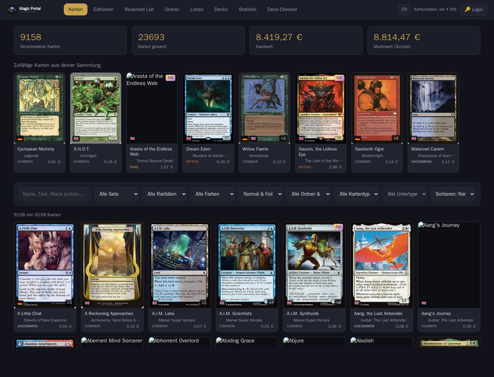
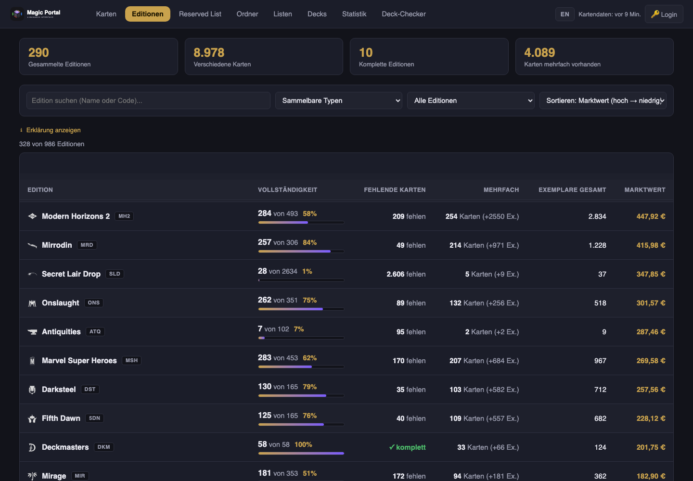
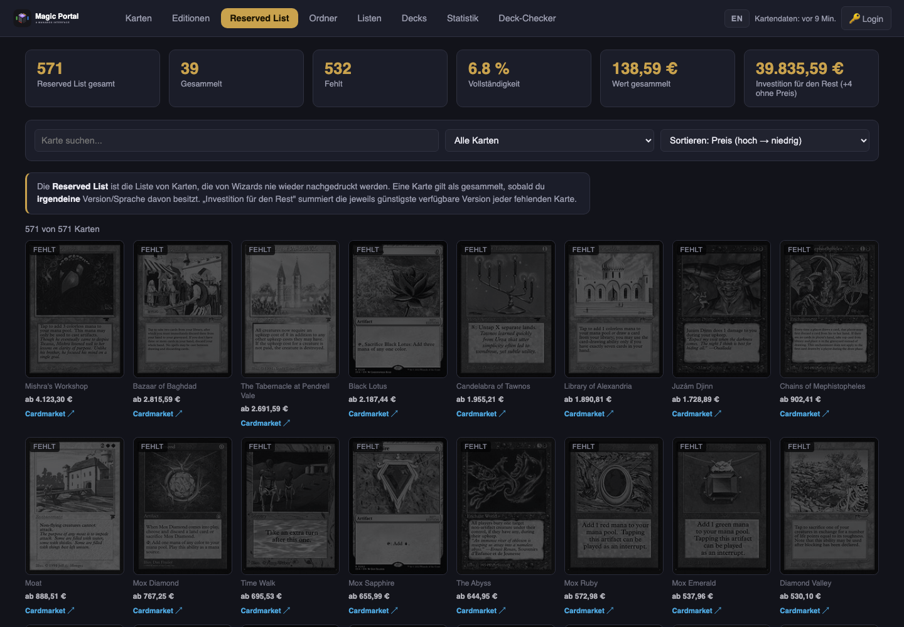
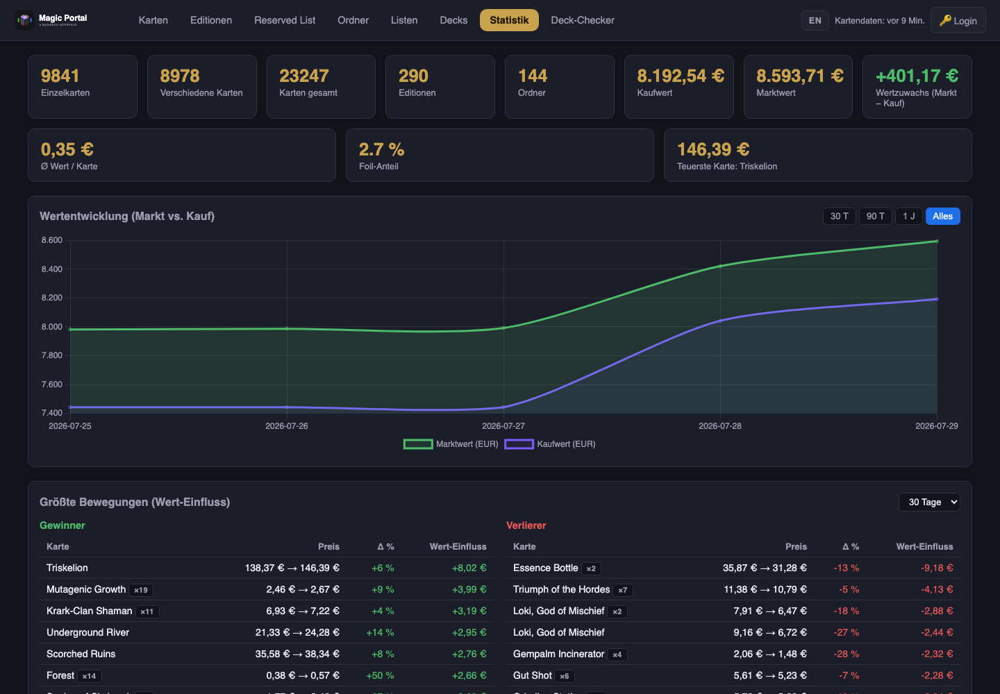

<p align="center">
  
</p>

<p align="center">
  <strong>A self-hosted web portal for your Magic: The Gathering collection, built from a ManaBox CSV export.</strong>
</p>

<p align="center">
  
  
  
  
  
</p>

<p align="center">
  🔗 <strong>Live demo:</strong> <a href="https://mtg.kirkanos.net">mtg.kirkanos.net</a>
</p>

---

Runs as a small Docker stack (nginx frontend + Go backend + SQLite). Card images, type lines
and **prices** come from [Scryfall](https://scryfall.com) and are kept up to date in the
background – the interface loads everything pre-enriched and fast from the API.
Inspired by [mtg-collection-viewer](https://github.com/pnz1990/mtg-collection-viewer).

## 📸 Impressions

|  |  |
|---|---|
| <br>*Card view: grid with filters, prices, language flags* | <br>*Editions: owned / missing / duplicates per set* |
| <br>*Reserved List: owned vs. missing + investment* | <br>*Statistics: value over time & biggest movers* |

<sub>Screenshots from the [live demo](https://mtg.kirkanos.net). Refresh them with `docs/screenshots.sh` (uses a headless Chrome container – no Node, no browser on the host required).</sub>

## ✨ Features

- **🗃️ Card view** – searchable, filterable grid (set, rarity, color, foil, **binder/list**, **card type & subtype** – e.g. Creature → Dragon, sorting including release date). The **set filter** is a searchable dropdown showing **set symbol + name** instead of codes. The same card in different languages is folded into **one** tile (total quantity + language flags); every tile shows the set symbol, the full set name and the rarity in its rarity color. The **keyword search** (AND) also covers rules text and mana cost (e.g. `create token soldier`, `2rr`, `wu`).
- **🔍 Card details** – mana cost as symbols, Oracle text, one row per language/finish/condition (binder / price / quantity / condition / date added) plus a gallery of **all other printings** of the card with image, edition and price. **Double-faced cards** (transform/MDFC) can be **flipped** to the back – in both the card dialog and the editions overlay.
- **📚 Editions** – per-set overview: owned / missing / duplicates, including sets you own **no** card from at all. Set-type filter (default: collectible types, up to "all"), an expandable explanation, sorting by missing cards and release date among others. A click opens an overlay with **every** card of the edition (missing ones greyed out), the set symbol, the value of the missing cards and – for owned cards – the binder. The card detail view links straight to the matching **Cardmarket** product.
- **🏛️ Reserved List** – an overview of Wizards' [Reserved List](https://magic.wizards.com/en/formats/reserved-list): which cards you own (any version/language counts) and which are missing, as a card grid (missing ones greyed out). Key figures: owned/missing count, completeness, **value of the owned** cards and the **investment needed to buy the rest** (cheapest available version each). Filter (all/owned/missing), search and sorting by price/name.
- **⭐ Wishlist** – mark cards you are missing with a ☆ wherever you notice they are missing: on the Reserved List, in an edition overlay, in the card detail view, or in the deck checker (including "put everything missing on the list" in one click). Its own page shows per entry the **cheapest printing** and its price, the **30-day change**, an optional **target price**, a **minimum condition** and a note. Cards you own in a worse condition than you want are flagged as an **upgrade**. A **"Copy for Cardmarket"** button renders the list in Cardmarket's decklist format, grouped by minimum condition and chunked to 150 entries. Marking and editing require a login, like every other write.
- **📁 Binders & lists** – dedicated overview pages for ManaBox binders and lists with card count and value; a click jumps to the filtered card view.
- **🧩 Decks** – menu entry for a future deck import/export (currently a placeholder, no functionality yet).
- **📊 Statistics** – a thorough dashboard: key figures (entries, cards, editions, binders, purchase/market value, gain market − purchase, average value, foil share, most expensive card) plus charts for rarity, colors, card types, languages, condition, mana value, foil, purchase value & additions over time, most valuable cards (purchase/market), **value-weighted** by color and rarity, price-bracket distribution and **detail tables** (rarity, editions) with entries, copies, market value, average value and share of value.
- **📈 Value over time** – the backend writes a daily (foil-aware) value snapshot of the collection. From that, the dashboard draws the **market vs. purchase value curve** over time (range 30 d / 90 d / 1 y / all) and the **biggest movers** (gainers/losers per range, weighted by the quantity you hold). History starts at deployment and grows forward (no retroactive price data).
- **✅ Deck checker** – paste a decklist and see which cards you already own.
- **🌐 Bilingual** – interface in German and English, switchable in the menu; the choice is remembered (default: German).
- **⬆️ CSV upload** – upload new ManaBox exports straight from the menu (password protected); the import **replaces** the collection's CSV rows entirely, so they match the CSV exactly (cards no longer in it disappear). Cards added by the Android app are kept.
- **🔄 Auto sync** – card data & prices are refreshed every 5 minutes in the background (downloading only when Scryfall has actually published a new dataset).
- **🧾 Activity log** – an "Activity" menu entry, visible **only while logged in**, shows the tool's recent actions (imports, syncs, backups, restores) including error messages. The log is **persistent** (survives restarts) and can be cleared at any time.
- **⚙️ Admin interface** – a gear icon in the top right, visible **only to logged-in users**, opens a settings overlay: the **random card strip** on the cards page (on/off + count), **hiding or showing individual menu entries** and the maintenance actions **clear collection / backup / restore** (stored server-side, applies to all visitors).
- **🎲 Random cards** – an optional strip of random cards from your collection at the top of the cards page (side by side, count configurable in the admin interface).

## 🏗️ Architecture

```text
            ┌── web (nginx) ───────┐   static interface, reverse proxy /api
 Port or    │                      │   → backend, local image mirror
 Traefik ───▶  mtg.example.com     │
            └──────────┬───────────┘
                       │ /api
            ┌──────────▼───────────┐   Go backend: REST API + background jobs
            │  backend (Go)        │   (SQLite in the "mtg-db" volume)
            └──────────────────────┘
```

Two containers, nothing else. Whether a reverse proxy sits in front or a port is simply
published is decided solely by the compose file you pick.

- Metadata, images and **prices** come from **Scryfall Bulk Data** – a daily full dump that the backend fetches in the background and stores in SQLite (instead of thousands of individual API calls in the browser).
- The background job runs **every 5 minutes**: it cheaply checks whether a new dump exists and downloads the ~140 MB only then. The set index is refreshed weekly.

## 🚀 Quick start

No extra infrastructure – just Docker:

```bash
docker compose -f docker-compose.standalone.yml up -d --build
```

That's it: **http://localhost:8080**. No Traefik, no external network, no `.env` needed.
The stack starts with an **empty collection** – upload your ManaBox CSV through the menu
(see below); the backend fetches the Scryfall data itself in the background.

The port deliberately binds to `127.0.0.1` only. To reach it from your home network:

```bash
BIND=0.0.0.0 HTTP_PORT=8080 UPLOAD_PASSWORD=secret \
  docker compose -f docker-compose.standalone.yml up -d --build
```

For good, both belong in a `.env` next to the compose file (`cp .env.sample .env`); every
variable in it applies to the standalone stack as well.

### Which compose file?

| File | What for |
|---|---|
| `docker-compose.standalone.yml` | **The normal case for running it yourself.** Publishes a port, nothing else. |
| `docker-compose.yml` | Running behind [Traefik](https://traefik.io) at `https://$HOST`, with the metrics port on a shared `traefik-network`. Expects that external network (`docker network create traefik-network`) and a `.env` with `SERVICE`/`HOST`/`PORT`. |
| `docker-compose.local.yml` | A test instance alongside a running server stack: own project name, own volumes, port `127.0.0.1:8088`, environment exclusively from `.env.local`. Write access to remote storage is hard-disabled. |

> All three build the same two images and differ only in how they are reachable.
> `docker compose` automatically reads a `.env` **next to the compose file** – starting the
> standalone stack in the same directory as a server `.env` inherits its settings (the
> automatic import, for instance). `--env-file /dev/null` starts it with nothing preset.

## 📥 Filling and updating the collection

Top right in the menu: **"🔑 Login"** → password → then **"⬆ Upload CSV"**, **"Clear"**,
**"💾 Backup"** and **"⟲ Restore"** appear (all actions are hidden until you log in).
The import **replaces** the collection entirely: afterwards the data matches the uploaded CSV
exactly – cards no longer in it are removed (atomically; on error the previous collection
stays intact). **"Clear"** removes the whole collection.

Every row knows where it came from (`origin`): `csv` for the ManaBox import, `app` for cards
the Android app added. The import replaces only the `csv` rows; app rows survive it, and the
same card may exist once from each source (all counts add them up).

ManaBox stays the master. To hand the app's cards over: export them (`POST
/api/collection/export`, a ManaBox CSV), import the file into ManaBox, then confirm the export.
The confirmation turns exactly the exported cards into `csv` rows – cards scanned or changed
in between stay app rows until the next handover.

Expected columns (standard ManaBox export):
`Name, Set code, Set name, Collector number, Foil, Rarity, Quantity, Scryfall ID, Purchase price, Purchase price currency, Condition, Language, Added`.

The **data timestamp** (last update of card data/prices) is shown at the top right of the menu;
**"🔄 Refresh"** triggers an immediate Scryfall sync.

## ⚙️ Configuration (`.env`)

Everything is optional – the standalone stack also runs without any `.env` at all.
The first three values are only needed when running behind Traefik:

| Variable | Purpose |
|---|---|
| `SERVICE` | Service name (container names, Traefik router, systemd unit, `/services/$SERVICE`) |
| `HOST` | Public domain (Traefik routing + TLS) |
| `PORT` | Internal port of the `web` container (nginx, 80) |
| `UPLOAD_PASSWORD` | Password for upload/reset/sync (empty = no protection) |

Standalone stack only:

| Variable | Purpose |
|---|---|
| `HTTP_PORT` | Published port (default `8080`). A separate name, because `PORT` above means the internal port Traefik routes to. |
| `BIND` | Address it binds to (default `127.0.0.1`, `0.0.0.0` = reachable on the network) |

Optional: `IMAGE_MIRROR` (default `false`) mirrors card images and symbols locally –
details in **[docs/roadmap.md](docs/roadmap.md)**.
`HASH_INDEX` (default `false`) builds the image hash index the Android scanner uses for
old and foreign cards: nightly at `HASH_SYNC_HOUR` (default 4), for `HASH_SCOPE`
`old` (default: old frame before July 2003 plus the collection), `collection` or `all`.
`SYNC_INTERVAL_MINUTES` (default 5) controls the background interval,
`METRICS_PORT` (default 9090, `off` = disabled) and `METRICS_CACHE_SECONDS` (default 30) the
Prometheus endpoint.
The database lives in the named volume `mtg-db`. The password travels in an
`X-Upload-Password` header (no browser login dialog).

### 📥 Automatic remote import (optional)

The backend can poll a Nextcloud and/or Google Drive file for a new ManaBox export and import
it automatically when it changes (full replace, just like a manual upload). Change detection
uses ETag/`Last-Modified` or the file checksum – unchanged files are not re-imported. All
fields are optional; empty = disabled. The **"🔄 Refresh" button** also triggers this check
manually (only when a source is configured); otherwise it just refreshes the Scryfall data.

| Variable | Purpose |
|---|---|
| `REMOTE_IMPORT_INTERVAL_MINUTES` | Poll interval (default 15) |
| `REMOTE_IMPORT_DELETE` | Delete the source file after a successful import (default `true`; `false` = keep it) |
| `WEBDAV_URL` | Direct WebDAV URL to the CSV (Nextcloud: `…/remote.php/dav/files/<user>/<path>/export.csv`) |
| `WEBDAV_USER` | Nextcloud user |
| `WEBDAV_PASSWORD` | Nextcloud **app password** (not the login password) |
| `GDRIVE_FILE_ID` | File ID of the CSV in Google Drive |
| `GDRIVE_SA_JSON` | Service account JSON (inline, base64-encoded or a path to a mounted file) |

**Google Drive:** create a service account in the Google Cloud Console, enable the Drive API
and share the CSV file (or its folder) with the service account's e-mail address. Read access
(`drive.readonly`) is enough for importing alone; with `REMOTE_IMPORT_DELETE` enabled the
write scope `drive` is requested and the file must be **deletable** by the service account
(editor permission; if it cannot be deleted permanently it is moved to the trash). Access is
implemented entirely with the Go standard library (JWT signing), without an extra dependency.

After a successful import the source file is **deleted** by default (via a WebDAV `DELETE` for
Nextcloud), so a fresh ManaBox export can simply be dropped in again. With
`REMOTE_IMPORT_DELETE=false` the file stays where it is.

The most recent remote import (time, source, any error) is reported under `/api/status`.

### 💾 Automatic backup (optional)

The **data that is yours and cannot be recreated** – the collection (`collection`), the value
history (`value_snapshots`, `price_history`) and the settings/metadata (`meta`, including the
admin `ui_config`) – is backed up regularly into a compact, gzip-compressed SQLite file and
uploaded as a **dated copy** to every configured source (Nextcloud via WebDAV `PUT`, Google
Drive via API). The Scryfall catalog (`scryfall_cards`, `sets`) is **not** backed up (it is
re-downloaded anyway – after a restore its tables are empty, which forces the download), so a
backup stays small (typically < 2 MB).

With an **empty database** (a fresh volume) the backend restores the latest remote backup
automatically on startup. Doing it manually works too – see the endpoints below.

| Variable | Purpose |
|---|---|
| `BACKUP_INTERVAL_HOURS` | Backup interval (default 24) |
| `BACKUP_KEEP` | Number of copies to keep; older ones are deleted (default 30, `0` = keep all) |
| `WEBDAV_BACKUP_DIR` | Target **folder** as a WebDAV URL (e.g. `…/remote.php/dav/files/<user>/mtg-backups/`); uses `WEBDAV_USER`/`WEBDAV_PASSWORD` |
| `GDRIVE_BACKUP_FOLDER_ID` | Target **folder ID** in Google Drive; uses `GDRIVE_SA_JSON` |

**Google Drive (backup):** the target folder must be shared with the service account's e-mail
address with **editor** permission. The backup requests the write scope `drive` (importing
alone still uses only `drive.readonly`).

Endpoints (password protected): `POST /api/backup` (back up now),
`POST /api/backup/restore-latest` (restore the latest remote backup),
`POST /api/backup/restore-upload` (restore an uploaded `.db.gz`). Backup status (time, file,
last restore, any error) is available under `/api/status`.

## 🔐 Deployment (Woodpecker CI + SOPS)

A push to `main` triggers the [Woodpecker](https://woodpecker-ci.org) pipeline
([`.woodpecker/pipeline.yaml`](.woodpecker/pipeline.yaml)):

1. **Decrypt** – `.env.enc` is decrypted to `.env` with [SOPS](https://github.com/getsops/sops) (age).
2. **Deploy** – sources are copied to `/services/$SERVICE`, the systemd unit is installed.
3. **Restart** – the service restarts and builds on the host via `docker compose up --build`.

Secrets (Woodpecker): `sops_age_key`, `ssh_host_local`.
Credentials live **encrypted** in [`.env.enc`](.env.enc); a plaintext `.env` is gitignored.

```bash
# Edit .env and re-encrypt it:
sops --encrypt --age <age-recipient> --input-type dotenv --output-type dotenv .env > .env.enc
```

## 📊 Analytics (optional)

**Off by default.** Without configuration no page loads a single line of third-party code,
nginx proxies nothing, and the HTML responses keep their `ETag`.

It is switched on with three variables in the `.env`; the last two are only needed for
providers that do it differently. Tested with self-hosted instances of
[Umami](https://umami.is) and [Plausible](https://plausible.io):

| Variable | Purpose |
|---|---|
| `ANALYTICS_SCRIPT_URL` | Upstream URL of the tracker script. **Empty = everything off.** |
| `ANALYTICS_EVENT_URL` | Upstream URL of the event endpoint. **Empty = everything off.** |
| `ANALYTICS_WEBSITE_ID` | The site's identifier at the provider |
| `ANALYTICS_ID_ATTRIBUTE` | Attribute carrying that identifier (default `data-website-id`; Plausible: `data-domain`) |
| `ANALYTICS_EVENT_PATH` | Local path for the events (default `/js/api/send`; Plausible: `/api/event`) |

```bash
# Umami
ANALYTICS_SCRIPT_URL=https://stats.example.com/script.js
ANALYTICS_EVENT_URL=https://stats.example.com/api/send
ANALYTICS_WEBSITE_ID=00000000-0000-0000-0000-000000000000

# Plausible
ANALYTICS_SCRIPT_URL=https://plausible.example.com/js/script.js
ANALYTICS_EVENT_URL=https://plausible.example.com/api/event
ANALYTICS_WEBSITE_ID=mtg.example.com
ANALYTICS_ID_ATTRIBUTE=data-domain
ANALYTICS_EVENT_PATH=/api/event
```

**How it works.** Every HTML page contains nothing but the placeholder `<!--analytics-->`. On
startup of the `web` container, `nginx/analytics.sh` turns that into two configuration
snippets: a `sub_filter` rule replacing the placeholder with the script tag, and two proxy
paths. The tracker is therefore served **first-party** from `/js/pl.js` on your own domain –
content blockers filter requests to known analytics hosts by default
(`ERR_BLOCKED_BY_CLIENT`). Cookies and `Authorization` deliberately do not travel to the
provider. Without the variables both snippets stay empty and the placeholder simply remains.

A quote character in any of the values would tear apart both the configuration and the HTML;
the script aborts at startup instead of serving something broken.

> Until October 2026 the only variable here was `UMAMI_WEBSITE_ID` and the provider was
> hard-coded in the nginx configuration. Coming from there, replace it with
> `ANALYTICS_WEBSITE_ID` and add the two URLs.

## 🛡️ Hardening

Both containers run with a `read_only` rootfs, `cap_drop: ALL` (web keeps only the caps nginx
needs), `no-new-privileges` plus memory and PID limits. The backend runs as a non-root user
(uid 10001); its port is not published – it is reachable only through the nginx proxy.

## 📈 Monitoring (optional)

The backend exposes Prometheus metrics on a separate port (`METRICS_PORT`, default `9090`)
that is deliberately **not** published through nginx/Traefik – the values reveal collection
value, binder names and error states. A ready-made Grafana dashboard, scrape config and alert
rules live in `docs/grafana/`; details in **[docs/monitoring.md](docs/monitoring.md)**.

## 🔌 API

| Method | Path | Purpose |
|---|---|---|
| `GET` | `/api/collection` | Collection, enriched with Scryfall data |
| `POST` | `/api/collection/owned` | Owned copies per card name, body `{"names": [...]}` (max. 500) – the deck checker without downloading the collection |
| `GET` | `/api/editions` | Completion per set: owned, missing, duplicates, value (ETag, conditional requests) |
| `GET` | `/api/sets` | Set index |
| `GET` | `/api/catalog/index` | The whole Scryfall catalog in compact form for the Android scanner's offline index (ETag over the content) |
| `GET` | `/api/catalog/card?set=…&number=…` | One printing of the catalog, with prices |
| `GET` | `/api/catalog/hashes` | Image hashes for the Android scanner, binary (`MPH1`, 32 bytes per printing, ETag) – only with `HASH_INDEX` |
| `GET` | `/api/catalog/search?name=…` | Name search that forgives typos and OCR errors, every printing newest first |
| `GET` | `/api/sets/{code}/cards` | All cards of a set, with the owned copies per language and binder |
| `GET` | `/api/prints?name=…` | All printings of a card (editions) |
| `GET` | `/api/binders` | Binders/lists with card count & value |
| `GET` | `/api/status` | Sync status & data timestamp |
| `GET` | `/api/summary` | Compact key figures (card count + collection value), public with CORS – for embedding |
| `GET` | `/api/dashboard` | Ready-made aggregates for the statistics page (ETag, conditional requests) |
| `GET` | `/api/cards` | Filtered, grouped and sorted page of results for the card grid |
| `GET` | `/api/cards/facets` | Values for the filter fields + key figures |
| `GET` | `/api/cards/random` | Random cards for the strip above the grid |
| `GET` | `/api/config` | UI settings (random cards, hidden menu entries) – public |
| `POST` | `/api/config` | Store UI settings (password protected) |
| `GET` | `/api/wishlist` | Wishlist with cheapest printing, price, 30-day change, target and what you own |
| `POST` | `/api/wishlist` | Add or update one entry (password protected) |
| `DELETE` | `/api/wishlist/{name}` | Remove one entry (password protected) |
| `GET` | `/api/wishlist/export` | The list in Cardmarket's decklist format (`text/plain`) |
| `GET` | `/api/auth-check` | Password check (204/403) |
| `POST` | `/api/collection/cards` | Add cards (Android app): `{"items":[{setCode, collectorNumber, quantity, foil, language, condition, binderName, binderType}]}`, one transaction, merges equal rows, name and IDs from the catalog; `Idempotency-Key` makes retries safe (password protected) |
| `GET` | `/api/collection/cards/{id}` | One collection row |
| `PATCH` | `/api/collection/cards/{id}` | Change `quantity` or `quantityDelta` (0 deletes), move with `binderName`/`foil`/`language`/`condition` – merges into an existing row; edits of CSV rows answer `volatile: true`, the next import resets them (password protected) |
| `DELETE` | `/api/collection/cards/{id}` | Remove one row (password protected) |
| `POST` | `/api/collection/export` | The app's cards as a CSV in exactly ManaBox's export format, for importing them into ManaBox; remembers what went out (`X-Export-Id`) (password protected) |
| `POST` | `/api/collection/export/{id}/confirm` | "ManaBox has imported it": moves exactly the exported quantities from app rows into csv rows, so the next ManaBox export counts them once (password protected) |
| `POST` | `/api/upload` | Upload CSV (replaces the CSV rows; app rows stay) |
| `POST` | `/api/reset` | Clear the collection; `?origin=csv` or `?origin=app` only that source's rows |
| `POST` | `/api/sync` | Trigger a Scryfall sync now |
| `POST` | `/api/images/sync` | Sync the image mirror now (only with `IMAGE_MIRROR`) |
| `POST` | `/api/hashes/sync` | Build the image hash index now (only with `HASH_INDEX`) |

## 🗂️ Project structure

```text
mtg-portal/
├── app/                     # nginx docroot (static interface)
│   ├── index.html · editions.html · reserved.html · wishlist.html · binders.html · lists.html
│   ├── decks.html · dashboard.html · deck-checker.html · activity.html
│   ├── css/style.css
│   ├── js/i18n.js · shared.js · grid.js · editions.js · reserved.js · wishlist.js
│   ├── js/binders.js · dashboard.js · deck-checker.js · activity.js
│   └── images/              # logo & favicons
├── backend/                 # Go backend (API + sync jobs)
│   ├── main.go · db.go · csvimport.go · scryfall.go · metrics.go
│   ├── cards.go · dashboard.go · reserved.go · wishlist.go · valuehistory.go · backup.go · images.go
│   └── Dockerfile
├── docs/
│   ├── monitoring.md        # metrics, scrape setup, dashboard
│   ├── roadmap.md           # planned work and the reasoning behind what is done
│   └── grafana/             # dashboard JSON, prometheus.yml excerpt, alert rules
├── nginx/
│   ├── default.conf.template   # static + proxy /api → backend + image mirror
│   └── analytics.sh            # builds the analytics snippets at startup
├── .woodpecker/pipeline.yaml
├── template.service         # systemd unit (template, %SERVICE%)
├── Dockerfile               # web image
├── docker-compose.standalone.yml # just Docker, one port – the normal case
├── docker-compose.yml       # server stack behind Traefik
├── docker-compose.local.yml # test instance next to the server stack (.env.local)
├── .env.enc                 # SOPS-encrypted secrets (.env is gitignored)
└── LICENSE
```

## 📄 License

[Apache License 2.0](LICENSE) – free to use, modify and redistribute, including an express
patent licence. For copyright notices see [NOTICE](NOTICE).

Card data and images come from [Scryfall](https://scryfall.com); *Magic: The Gathering* is a
trademark of Wizards of the Coast. This project is not affiliated with Wizards of the Coast
or ManaBox.
